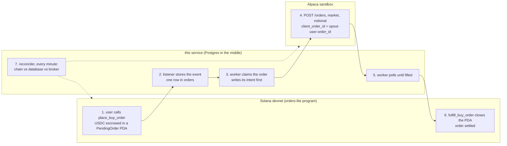
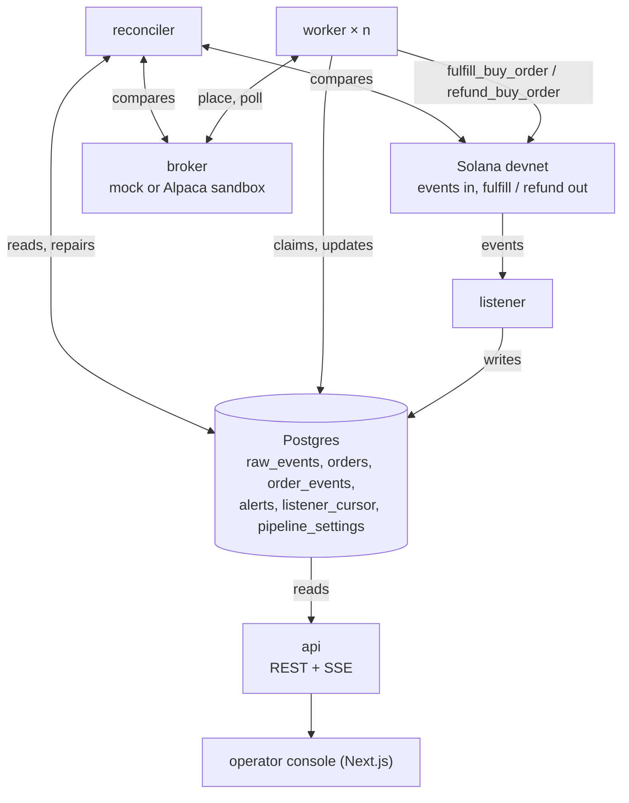
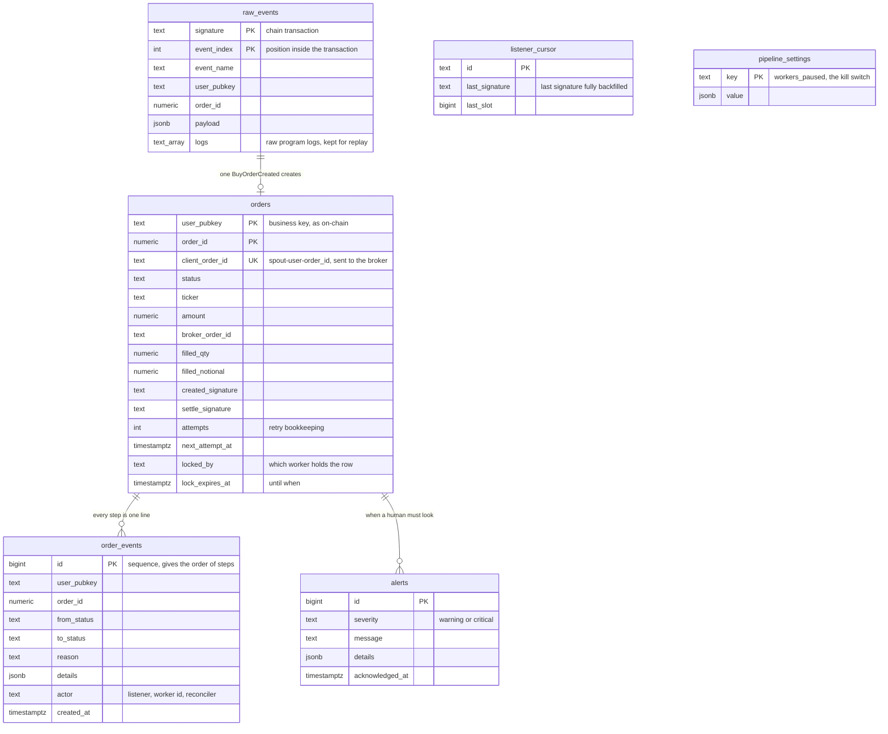
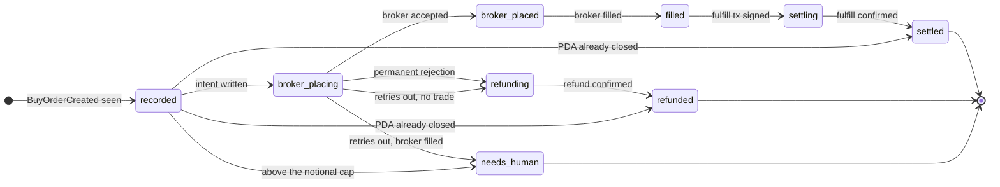
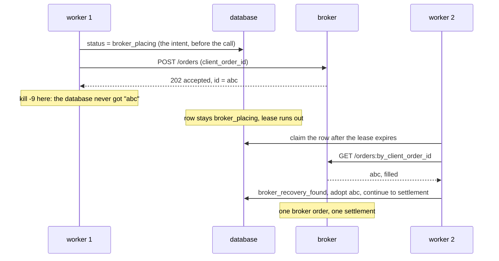
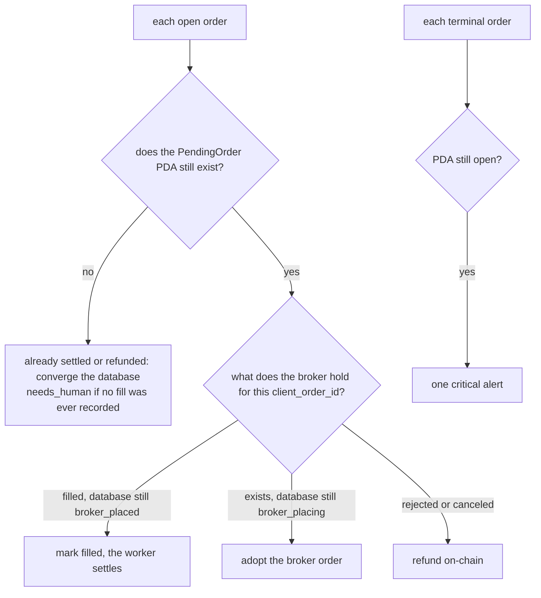

# Spout settlement worker


A user buys a tokenized US stock on Solana. Behind the scenes, someone has to buy the real share at a brokerage, then tell
the chain that the purchase is done. This service is that "someone".

It listens to orders on Solana devnet, executes them at the Alpaca Broker API sandbox, and settles them back on-chain.
The dangerous moment is the gap between "the real share was bought" and "the chain knows it": this service is built so
that gap is short, visible, and impossible to execute twice.

## 1. The loop in one picture



How to read it, step by step:

1. **The user places an order on-chain.** The program creates a small account (a PDA, "PendingOrder") that holds the USDC
   and emits a `BuyOrderCreated` event.
2. **The listener hears the event** and writes one row in Postgres. Nothing else happens yet.
3. **A worker takes the row** and, before doing anything external, writes in the ledger that it is about to call the broker.
   If it crashes right after, the next worker knows what to check.
4. **The worker places the order at the broker.** The order id sent to the broker is computed from the user and the order
   number, so the same order can never be placed twice: the broker refuses a duplicate id.
5. **The worker waits for the fill**, polling the broker every couple of seconds.
6. **The worker settles on-chain** by calling `fulfill_buy_order`, which closes the PDA. The order is done.
7. **A reconciler keeps watch** and repairs the three sources of truth (chain, database, broker) if they disagree.

If the broker rejects the order for a permanent reason (market closed, unknown symbol), the worker calls
`refund_buy_order` instead of step 6: the USDC goes back to the user and the order ends `refunded`.

**Stack.** TypeScript, NestJS 11, TypeORM, PostgreSQL 16, `@coral-xyz/anchor` 0.31, `@solana/web3.js` 1.98, Next.js 15
operator console. One pnpm workspace, one backend Docker image, five roles chosen with
`ROLE=listener|worker|reconciler|api|mock-broker`. No message queue: the `orders` table is the queue.

**Integrations are real.** The `orders-lite` program on devnet (`DB2h5equ9Qp2qaaeKyL9sL6RD8LAhZzjiSUYgnaW3aeF`) and the
Alpaca Broker API sandbox. A mock broker with the same interface is used to simulate failures (outages, rejections, slow
fills) on demand.

## 2. Run it

Prerequisites: Docker with Compose v2, Node 22 or 24, pnpm 9 (`corepack enable`), Solana CLI for the keypair.

```bash
solana-keygen new -o keys/devnet-keypair.json          # places orders (user) and settles them (platform co-signer)
solana airdrop 2 -k keys/devnet-keypair.json -u devnet  # or https://faucet.solana.com
cp .env.example .env                                    # Alpaca sandbox credentials from the assignment appendix, never committed

docker compose up --build                               # postgres, mock-broker, api :4000, listener, 2 workers, reconciler, web :3000

pnpm install                                            # in a second shell
pnpm place-order AAPL 25 --wait                         # real devnet order, followed until it settles
```

Console: http://localhost:3000. API: http://localhost:4000 (`/orders`, `/orders/:user/:orderId/events`, `/alerts`,
`/stream`, `/reconcile`, `/replay`, `/workers/pause|resume`). `BROKER=mock` (default) or `BROKER=alpaca` (section 9).

The public devnet RPC is rate limited. Requests are paced and retried, so `rpc retry` warnings in the logs are normal; a free
Helius or QuickNode devnet URL in `RPC_URL` makes a demo smoother.

## 3. Demo walkthrough

Five minutes, in this order. Every step is visible in the console and in the API.

1. Open the console. The header shows the active broker and the settlement wallet.
2. `pnpm place-order AAPL 25 --wait`. Watch the order go `recorded`, `broker_placing`, `broker_placed`, `filled`, `settling`,
   `settled`. Open it: the Record panel shows the broker order and the settlement signature (explorer link); the Ledger panel
   shows every transition with its reason, who did it and when.
3. Chaos lab, "http 500", then place another order. The order retries with growing delays (`retry_scheduled` lines carry the
   delay), then completes when the outage clears. No refund, no dead letter.
4. Chaos lab, "market closed", place an order. The broker rejects it, the worker calls `refund_buy_order`, the order ends
   `refunded`. No retries: the rejection is permanent.
5. `pnpm scenario b`. A worker is killed right after the broker accepted and before the database write; the ledger shows the
   restart recovering the trade through `by_client_order_id`. One broker order, one settlement.
6. "Reconcile now" after `pnpm scenario f`: a fill the poller missed and a PDA closed behind the database's back are both
   repaired, each with a `reconciled_*` reason.
7. The Alerts panel and the "Workers" card show the safety rails: anything a human must look at, and the kill switch.

## 4. What runs

Five processes, one database. They never talk to each other directly: everything goes through Postgres.



| Role | Job | Where it cannot double-execute |
|---|---|---|
| `listener` | Subscribes to the program logs (commitment `confirmed`), decodes events with the IDL, writes `raw_events` and `orders`. A periodic backfill (`getSignaturesForAddress` from the last cursor) fills anything a dropped socket missed. | Inserts are `ON CONFLICT DO NOTHING` on `(signature, event_index)` and on `(user, order_id)`. |
| `worker` (n instances) | Claims orders, drives the state machine, talks to the broker and the chain. | Deterministic `client_order_id`, intent written before every external call, fenced transitions, row leases. |
| `reconciler` | Every `RECONCILE_INTERVAL_MS`, compares broker, database and chain and repairs drift. | Same ledger transitions and leases as the workers. |
| `api` | REST and SSE for the console and the scripts; runs the migrations. | Admin token on every mutating endpoint when `ADMIN_TOKEN` is set. |
| `mock-broker` | In-memory Alpaca stand-in with fault injection (env flags and seed, or the admin API). | A duplicate `client_order_id` answers 409 with the original order. |

Only `BuyOrderCreated` events of the wallet in `KEYPAIR_PATH` become orders: on this program the settling key must be the
order's user (`has_one = user` in `CloseOrder`), so other keypairs' orders on the shared devnet program are captured in
`raw_events` and skipped. Sell orders are captured, not settled.

## 5. Data model

Six tables. Two of them are append-only journals (nothing is ever updated or deleted), one is the current state, and the
rest is operational bookkeeping.



In plain words:

- **`raw_events`** is the tape recorder. Every program event is stored exactly as received, with the raw logs, so it can
  be replayed later. Two identical events cannot be stored twice: the primary key is the transaction signature plus the
  position of the event inside it.
- **`orders`** is the dashboard. One row per order, showing where it is right now. It is rebuilt from the journal, so it can
  be wrong only for a moment, never permanently.
- **`order_events`** is the audit log. Every status change, and every notable non-change (a retry scheduled, a recovery
  lookup, a duplicate ignored), is one line with a reason and the actor who did it. The full history of an order is
  `SELECT * FROM order_events WHERE user_pubkey = $1 AND order_id = $2 ORDER BY id`.
- **`alerts`** is the inbox for humans. Every path that gives up writes one row. The console shows unacknowledged alerts first.
- **`listener_cursor`** remembers how far the backfill got, so a listener restart resumes instead of re-scanning.
- **`pipeline_settings`** holds the kill switch, in the database so every replica obeys it.

Three rules hold everything together:

1. **`order_events` is the truth, `orders` is a projection.** `LedgerService.transition()` is the only way a status changes.
   It updates the row and inserts the ledger line in one transaction, and the update is fenced on the expected current status
   (`WHERE status = :from`). Two processes can never apply the same transition, even if a lease lapsed.
2. **`(user_pubkey, order_id)` is the business key**, exactly as on-chain. The `order_id` is a per-user counter, so the pair is
   unique across the program.
3. **`client_order_id` is derived, never generated.** `spout-<user>-<order_id>` is computed from the business key before any
   broker call and stored unique. Every process, retry and replay computes the same id, so the broker's own duplicate check is
   the exactly-once backstop.

## 6. Life of an order



The top row is the happy path. Everything below it is a deliberate exit, never a loop.

What each status means:

| Status | Meaning |
|---|---|
| `recorded` | The chain event was seen and stored. Nothing external has happened yet. |
| `broker_placing` | A worker is about to call the broker, or was when it died. The next worker must check before placing again. |
| `broker_placed` | The broker accepted the order and gave it an id. We are waiting for the fill. |
| `filled` | The broker bought the shares. From here the order can only be settled, never refunded. |
| `settling` | The settlement transaction is signed and being sent. |
| `settled` | `fulfill_buy_order` landed, the PDA is closed. Terminal. |
| `refunding`, `refunded` | The broker did not trade; `refund_buy_order` returns the USDC. Terminal. |
| `needs_human` | The service cannot decide safely on its own (money at the broker, but the chain side is unclear). Terminal, with a critical alert. |

A real ledger, taken from the hosted stack (order `1788788980019`, AAPL, 5 USDC, settled in 7 seconds):

| Time | Transition | Reason | Actor |
|---|---|---|---|
| 13:49:41 | recorded | event_ingested | listener |
| 13:49:41 | recorded -> broker_placing | broker_intent_recorded | worker |
| 13:49:41 | broker_placing -> broker_placed | broker_accepted | worker |
| 13:49:45 | broker_placed -> filled | broker_filled | worker |
| 13:49:46 | filled -> settling | settlement_started | worker |
| 13:49:46 | settling | fulfill_tx_signed | worker |
| 13:49:47 | settling | chain_event_BuyOrderFulfilled | listener |
| 13:49:48 | settling -> settled | fulfill_confirmed | worker |

Two lines matter most: `broker_intent_recorded` is written before the broker call, and `fulfill_tx_signed` is written before
the transaction is sent. They are what a crashed worker resumes from.

## 7. Guarantees, one by one

### Idempotency: the same thing can happen many times, it is applied once

In plain words: events can arrive twice, workers can retry, operators can replay. None of that creates a second trade or a
second settlement.

- Chain events dedupe on the primary keys of `raw_events` and `orders`.
- Broker placement uses the deterministic `client_order_id`. A 409, or Alpaca's 422 `client_order_id must be unique`, is
  answered by adopting the existing broker order instead of failing.
- On-chain, Anchor error 3012 `AccountNotInitialized` (the PDA is already closed) is classified `already_settled` and recorded
  as a success.
- Before any trade the worker checks that the PDA still exists, so a replayed event for an order already fulfilled or refunded
  never reaches the broker.
- Nothing is deduplicated in memory. A restart forgets nothing because nothing was only in memory.

### Crash safety: the worst moment to die

In plain words: the worker writes down what it is about to do before doing it. Whoever picks the order up next reads that
note and checks with the outside world before acting.



- `broker_placing` is written before the broker call. The next worker to claim an order in that state first asks
  `orders:by_client_order_id` and adopts what it finds, fill included; only then does it place.
- For settlement, the transaction is signed and its signature persisted before the send. A retry checks
  `getSignatureStatuses` and the PDA before re-sending, and a re-send that hits 3012 is a success. The first signature ever sent
  is kept as `settle_signature`.

### Concurrent workers: two workers never touch the same order

In plain words: a worker takes a ticket on the row with an expiry date. A dead worker's ticket expires on its own, and even if
two workers ever held the same ticket, the database refuses the second identical move.

- Claims use `SELECT ... FOR UPDATE SKIP LOCKED` plus a lease (`lock_expires_at`, heart-beaten during a step).
- A `kill -9` releases nothing, so the lease is what makes the row claimable again; scenario B shows the `LEASE_SECONDS`
  pause before recovery. Worker ids are unique per process.
- Fenced transitions (`WHERE status = :from`) are the second line of defence if a lease ever lapses mid-step.

### Retries: only what can heal is retried, and it stops

In plain words: a broker outage is retried with growing waits. A "no" from the broker is final. When retries run out, the
worker checks whether money moved before deciding what to do.

- Every broker and chain failure is classified at the edge. Transient (5xx, 429, 401, timeouts, connection errors, blockhash
  expiry, lost confirmation) retries with `min(60 s, 1 s * 2^n)` and jitter, at most `RETRY_MAX_ATTEMPTS` (10) consecutive
  failures. A successful broker poll resets the budget, so an order may wait for the market to open.
- Permanent (business rejections, program constraint errors) never retries.
- On exhaustion the worker reverts deliberately, in this order:
  1. ask the broker `by_client_order_id`;
  2. no trade: refund on-chain, `refunded`, warning alert;
  3. open trade: cancel it, re-read, and refund only once the broker confirms nothing filled;
  4. filled: `needs_human` with a critical alert, never refunded.
- Failures while settling a filled order can only end in `needs_human`.

### Money rule: a filled order is never refunded

An order the broker filled, even partially, is never refunded. A partial fill that the broker then closes is settled for the
filled notional (`actual_usdc`, capped by the escrowed amount) and raises a warning for the operator.

### Reconciliation: three sources of truth, one job to make them agree

In plain words: every minute, a job looks at each open order and asks the chain first ("does the PDA still exist?"), then
the broker ("what do you have for this id?"), and fixes the database to match reality.



`ReconcileService.run()` takes the same leases as the workers. It runs on a timer, on demand (`pnpm reconcile`,
`POST /reconcile`) and from the console.

### Commitment levels: `confirmed` everywhere

Everything runs at `confirmed`: the listener, the polls, the settlement send and its confirmation. A confirmed slot is a
supermajority optimistic confirmation; its rollback is not expected in practice, and `finalized` would add about 13 seconds
to each of the three legs. The residual risk (a `BuyOrderCreated` rolled back after the broker traded) is caught by the PDA
check before settlement and surfaces as `needs_human`, never as a silent double trade.

### RPC transport

One hardened `Connection` per process (`chain/rpc.ts`): paced, 429-aware fetch with endpoint failover (`RPC_URLS`), and
confirmation by polling signature statuses with a blockhash-expiry check instead of a websocket subscription.

## 8. Safety rails

Beyond the guarantees above, the service assumes something will eventually go wrong and limits the blast radius.

| Rail | Setting | Behaviour |
|---|---|---|
| Notional cap | `MAX_ORDER_USDC` (10 000) | Larger orders are never traded automatically; they land in `needs_human` with an alert for manual approval. |
| Circuit breaker | `CIRCUIT_BREAKER_ALERTS` (3) in `CIRCUIT_BREAKER_WINDOW_MS` (10 min) | A burst of critical alerts pauses every worker through the kill switch; in-flight steps finish, nothing new starts until `POST /workers/resume`. |
| Kill switch | `POST /workers/pause` | Operators stop all broker and chain side effects instantly, without killing processes. Stored in Postgres, so every replica obeys it. |
| Admin token | `ADMIN_TOKEN` | When set, every mutating endpoint (pause, replay, reconcile, drift, mock faults, alert ack) requires `x-admin-token`. The console accepts `?token=`. |
| Sandbox only | `ALPACA_ALLOW_LIVE` | The process refuses to start against a non-sandbox Alpaca host unless explicitly allowed. |
| Dead letters | `alerts` | Every path that gives up writes an alert row with the order key and the reason; the console shows unacknowledged alerts first. |
| Process guards | | Unhandled rejections are logged and never crash a worker; the order stays leased and is retried like any transient failure. |

## 9. The real Alpaca sandbox

Auth is OAuth2 client credentials; the token is cached and refreshed a minute early, and a 401 triggers one forced refresh
before being treated as transient. Orders are `market`, `time_in_force: day`, `notional` in dollars at two decimals.
Findings from probing the sandbox (`apps/api/scripts/alpaca-probe.ts`):

- A duplicate `client_order_id` is answered with `422 {"code":42210000,"message":"client_order_id must be unique"}`, not 409.
  The message identifies the duplicate; 42210000 is Alpaca's generic validation code.
- Outside regular hours the sandbox accepts notional orders and holds them `accepted` until the next open, so scenario G only
  completes during US market hours (15:30 to 22:00 Paris). The worker keeps polling until then.
- `actual_usdc` reported on-chain is `filled_qty * filled_avg_price` at six decimals, never above the escrowed amount.
- `pnpm alpaca-account` lists the sandbox accounts for the shared key and prints the `ALPACA_ACCOUNT_ID` to use.

Scenario G ran on 8 September 2026 at 15:31 Paris on the hosted stack switched to `BROKER=alpaca`: order `BLcWH9…/1788874263163` (AAPL, 5.00 USDC), `BuyOrderCreated` [5Xg9sQxC…pjEnS4](https://explorer.solana.com/tx/5Xg9sQxC8hwZKUKx7XmTs9JbhbyhcrwKyYtfQLLP4w1mhqJVT9UpuhbJkY4RHBF7HS187jMH7QEL8ch6bdpjEnS4?cluster=devnet), Alpaca order `747d7e45-e2cd-4303-b7d7-3d59d3a3eed7` filled 0.015598624 shares for $4.990000, `fulfill_buy_order` [4iekPPpm…JjduCU](https://explorer.solana.com/tx/4iekPPpmsADwEBFE9m97E9xvswAgNTQVKFRSugSMt4s1PpjZv6LiJshEieBSXW4fo4gzbdj5inRcQnyE2cJjduCU?cluster=devnet), settled 4 s after the event, 0 retries. Full ledger, script output and console screenshots: [docs/scenario-g-2026-09-08.md](docs/scenario-g-2026-09-08.md).

## 10. Scenarios A to G

Each scenario is a script that places a real order on devnet, drives it through the stack and asserts the outcome from the
database, the mock broker and the chain. Stack up, from the repo root, one at a time:

```bash
pnpm scenario a          # ... b, c, d, e, f, g
pnpm concurrency 6       # six orders across two workers: one placement, one settlement, one broker order each
```

| | Mechanism | Expected |
|---|---|---|
| A | Order settles, then its `BuyOrderCreated` transaction is pushed through `POST /replay` three times, decoded from the logs stored in `raw_events`. | `newOrders=0` each time, three `duplicate_event_ignored` lines, one broker order, same `settle_signature`. |
| B | Regular workers paused; a worker started with `WORKER_CRASH_POINT=after_broker_accept` exits with code 137 after the broker's 202, before the database write; workers resumed. | Database stuck in `broker_placing` with no broker id while the broker holds one order; after the lease expires a worker logs `broker_recovery_found` and settles; broker count stays 1. |
| C | `POST /admin/faults {mode:"http500", durationMs:30000}`, then an order. | `retry_scheduled` lines with delays near 1, 2, 4, 8, 16 s, then `broker_accepted` and `settled`; no refund, no dead letter. |
| D | A worker started with `CHAIN_FAULT=drop_confirmation`: the settlement is sent, then the confirmation is reported lost and the RPC is treated as blind. | Attempt 1 `retry_scheduled`; attempt 2 re-sends, preflight fails with 3012, `already_settled_3012`, `settled`. One settled transition, no loop. |
| E | `POST /admin/faults {mode:"market_closed"}`. | 422, `broker_rejected {code: market_closed}`, `refund_buy_order`, `refunded`; zero retries. |
| F | F1: long fill delay, fill forced at the broker, poller frozen (`/drift`), `POST /reconcile`. F2: settled order drifted back to `settling` with no signature, `POST /reconcile`. | F1 `reconciled_broker_filled` then the worker settles. F2 `reconciled_pda_closed` without sending anything. |
| G | `BROKER=alpaca`, restart, `pnpm scenario g AAPL 5` during US market hours. | Devnet event, sandbox order `accepted`, fill, `fulfill_buy_order`; the script prints both explorer links and the Alpaca order id. |

A guided manual run of steps 2 to 7 on the hosted stack, with the real order ids, ledgers and explorer links, is in
[docs/manual-run-2026-09-07.md](docs/manual-run-2026-09-07.md), also as a printable report:
[docs/manual-run-2026-09-07.pdf](docs/manual-run-2026-09-07.pdf).

Manual variant of B: set a long fill delay, place an order, `docker compose kill -s SIGKILL worker` while it is in
`broker_placing`, `docker compose up worker`, and watch `broker_recovery_found` after the lease expires.

Chaos hooks used by the scripts and by the console: mock faults (`http500`, `slow` 2 to 10 s, `flaky`, `market_closed`, fill
delay, seed), `POST /workers/pause|resume`, `POST /orders/:user/:id/drift` (writes a `scenario_drift_injected` ledger line),
`POST /mock/orders/:id/fill|reject`, `POST /replay`, `POST /reconcile`; `WORKER_CRASH_POINT` and `CHAIN_FAULT` are worker env
flags. All of it is demo tooling, gated by `ADMIN_TOKEN` outside local development.

## 11. Failure modes

| What fails | What happens | Who notices |
|---|---|---|
| Websocket drops or replays events | Duplicates hit `ON CONFLICT DO NOTHING`; gaps are filled by the backfill from `listener_cursor`, which only the backfill advances | `duplicate_event_ignored` lines, listener log |
| Listener down for an hour | Nothing lost: the backfill resumes at the cursor and pages past 1000 signatures | cursor age |
| Event replayed for an order already closed on-chain | PDA check before trading: closed to `settled` or `refunded` from the captured events, no broker call | `pda_closed_before_processing` |
| Broker 5xx, timeout, 429, 401 | Transient: backoff retry, at most 10 consecutive failures | `attempts` in the console, `retry_scheduled` lines |
| Broker rejects (market closed, bad symbol) | Permanent: `refund_buy_order`, `refunded` | `broker_rejected` line with code |
| Worker killed after the broker's 202, before the database write | Row stays `broker_placing`; lease expires; next claimer adopts the order through `by_client_order_id` | `broker_recovery_found` |
| Worker killed after the settlement was signed | Signature persisted before the send; retry checks its status and the PDA, re-sends only if nothing landed; 3012 is success | `settlement_signature_recheck`, `already_settled_3012` |
| Confirmation lost, transaction landed | Same as above | idem |
| Retries exhausted, no broker trade | Refund on-chain, `refunded`, warning alert | `retries_exhausted_no_broker_trade` |
| Retries exhausted, broker order still open | Cancel, re-read until final; refund only if nothing filled | `broker_cancel_confirmed` or `needs_human` |
| Retries exhausted, broker filled | `needs_human`, critical alert, nothing reverted | alerts, `NEEDS HUMAN` counter |
| Broker fills during the cancel window | `needs_human`, critical alert, never refunded | `filled_at_broker_while_refunding` |
| Partial fill then closed by the broker | Settled for the filled amount, warning alert | `broker_filled_partial` |
| Broker unreachable for the exhaustion lookup | `needs_human` (absence cannot be proven) | critical alert |
| Poller misses a fill | Reconciler: broker says filled, `filled`, worker settles | `reconciled_broker_filled` |
| Database says pending, PDA already closed | Reconciler converges to `settled` or `refunded`, or `needs_human` if no fill was ever seen | ledger, alert |
| Database says settled, PDA still open | One critical alert | alerts |
| Two workers claim at once | `FOR UPDATE SKIP LOCKED`, disjoint rows; fenced transitions if a lease lapses | `locked_by` |
| Burst of critical alerts | Circuit breaker pauses the workers | alert, `Workers` card |
| Order above the notional cap | `needs_human` before any trade | alert |
| Public devnet RPC rate limits | Paced, retried, failover to `RPC_URLS`; stray rejections never crash a worker | `rpc retry` warnings |
| Program rejects the instruction (`WrongOrderSide`, constraint) | Permanent: `needs_human`, critical alert | alert |
| Another keypair's order on the shared program | Captured, not processed | listener `foreign=` counter |

## 12. Tests

```bash
pnpm --filter @spout/api test    # 27 unit tests: retry policy and error classification (3012, 5xx vs 4xx, 401),
                                 # Alpaca status mapping incl. partial fills, duplicate detection, mock broker contract
                                 # and faults, ledger fencing and circuit breaker, amount conversions, state machine
pnpm typecheck                   # strict TypeScript across api, web, shared
pnpm scenario a ... g            # integration against the real devnet program with the mock or the sandbox
```

## 13. Hosting

The backend runs on Railway as five services built from the same `apps/api/Dockerfile` (`RAILWAY_DOCKERFILE_PATH`), each with
its `ROLE`, plus a managed Postgres referenced as `${{Postgres.DATABASE_URL}}`. Services talk over Railway's private network
(`mock-broker.railway.internal`), which is IPv6, so every listener binds `::`. The keypair is passed as `KEYPAIR_JSON`, and
`ADMIN_TOKEN` is set because the API is public. Deploy from a checkout with `railway up --service <name>`.
Live API: https://api-production-1d80.up.railway.app (mock broker; the local stack and the hosted one share the devnet keypair,
so pause one side's workers before running scenarios on the other).

The console is a static Next.js build pointed at `NEXT_PUBLIC_API_URL`; it also accepts `?api=<url>` and `?token=<admin token>`
at runtime. `scripts/deploy-web.sh` builds it on Linux in Docker and stages a symlink-free tree; `vercel deploy --prebuilt --prod`
from that tree publishes it. Live: https://spout-settlement-console.vercel.app

## 14. What was cut, and what two more weeks would add

Cut on purpose, a smaller solution that nails A to G over a larger one:

- Sell orders (`SellOrderCreated`, `fulfill_sell_order`): captured, not settled; the steps are symmetric.
- Alpaca's SSE trade stream instead of polling: an optimisation feeding the same `filled` transition.
- The USDC off-ramp to the whitelisted deposit ATA and minting `smockAAPL` on fulfilment: `orders-lite` moves no tokens
  (ONCHAIN.md: escrows are "not part of the assessment in any form"), and neither appears in the hard requirements or in
  scenarios A to G. The hooks would sit next to `fulfill_confirmed`.
- Broker account and position cross-checks in the reconciler: per-symbol positions versus the sum of filled quantities.
- Ticker normalisation (`sAAPL` to `AAPL`, allowlist) before placement; today an unknown ticker is refunded after the broker's
  rejection, which is safe but costs a round trip.
- Postgres integration tests for the claim query and the ledger; the scenarios cover them end to end.

Two more weeks: partial fills and price protection against an oracle; a `broker_orders` table (one row per attempt) and a
`settlement_txs` table; an outbox-style chain sender with durable nonces and `finalized` before reporting to the user; the sell
flow, SSE fills, priority fees and a private RPC with failover; metrics, dashboards and paging on `needs_human` with a runbook
per ledger reason; an operator action to re-drive a `needs_human` order once a human has decided.

## 15. Hours

TBD by the author.
