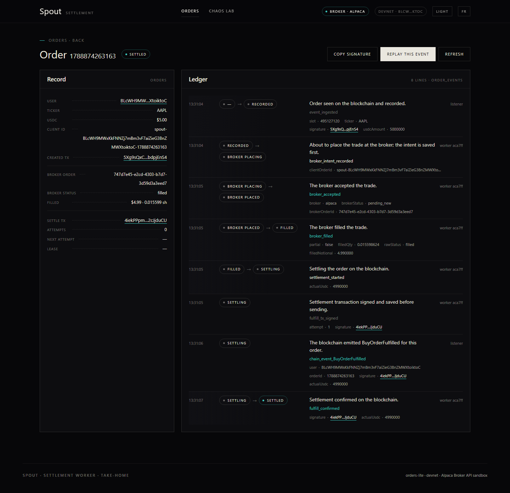
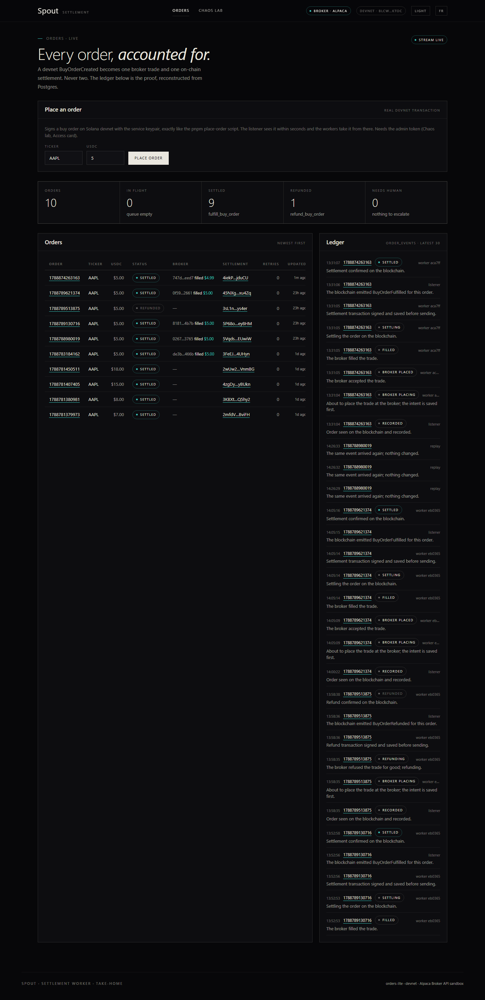

# Scenario G: one real order through the Alpaca sandbox, 8 September 2026

Run at 13:31:04 UTC (15:31 Paris) against the hosted stack (API on Railway, console on Vercel)
switched to `BROKER=alpaca`, with `pnpm scenario g AAPL 5` from the repo root and `API_URL` pointing at the hosted API.
The order was placed on Solana devnet with the service keypair, executed at the Alpaca Broker API sandbox as a notional
market order, and settled back on devnet with `fulfill_buy_order`. Settled 4 seconds after the event was recorded.

| | |
|---|---|
| Order | `BLcWH9MWxKkFNNZj7mBm3vF7aiZieG3BnZMWXtoiktoC/1788874263163` (AAPL, 5.00 USDC) |
| `BuyOrderCreated` | [5Xg9sQxC…pjEnS4](https://explorer.solana.com/tx/5Xg9sQxC8hwZKUKx7XmTs9JbhbyhcrwKyYtfQLLP4w1mhqJVT9UpuhbJkY4RHBF7HS187jMH7QEL8ch6bdpjEnS4?cluster=devnet) |
| `client_order_id` | `spout-BLcWH9MWxKkFNNZj7mBm3vF7aiZieG3BnZMWXtoiktoC-1788874263163` |
| Alpaca order id | `747d7e45-e2cd-4303-b7d7-3d59d3a3eed7` (last status seen `filled`) |
| Filled | 0.015598624 shares, $4.990000 notional |
| `fulfill_buy_order` | [4iekPPpm…JjduCU](https://explorer.solana.com/tx/4iekPPpmsADwEBFE9m97E9xvswAgNTQVKFRSugSMt4s1PpjZv6LiJshEieBSXW4fo4gzbdj5inRcQnyE2cJjduCU?cluster=devnet) |
| Retries | 0 |

## Ledger (`order_events`, as served by the API)

| Time (UTC) | Transition | Reason | Actor | Details |
|---|---|---|---|---|
| 13:31:04 | `recorded` | `event_ingested` | listener:ws | `{"signature": "5Xg9sQxC8hwZKUKx7XmTs9JbhbyhcrwKyYtfQLLP4w1mhqJVT9UpuhbJkY4RHBF7HS187jMH7QEL8ch6bdpjEnS4"}` |
| 13:31:04 | `recorded -> broker_placing` | `broker_intent_recorded` | worker:aca7ffedc1b1:1:0433 |  |
| 13:31:05 | `broker_placing -> broker_placed` | `broker_accepted` | worker:aca7ffedc1b1:1:0433 | `{"brokerOrderId": "747d7e45-e2cd-4303-b7d7-3d59d3a3eed7"}` |
| 13:31:05 | `broker_placed -> filled` | `broker_filled` | worker:aca7ffedc1b1:1:0433 | `{"filledQty": "0.015598624", "rawStatus": "filled", "filledNotional": "4.990000"}` |
| 13:31:05 | `filled -> settling` | `settlement_started` | worker:aca7ffedc1b1:1:0433 |  |
| 13:31:05 | `settling` | `fulfill_tx_signed` | worker:aca7ffedc1b1:1:0433 | `{"attempt": 1, "signature": "4iekPPpmsADwEBFE9m97E9xvswAgNTQVKFRSugSMt4s1PpjZv6LiJshEieBSXW4fo4gzbdj5inRcQnyE2cJjduCU"}` |
| 13:31:06 | `settling` | `chain_event_BuyOrderFulfilled` | listener:ws | `{"signature": "4iekPPpmsADwEBFE9m97E9xvswAgNTQVKFRSugSMt4s1PpjZv6LiJshEieBSXW4fo4gzbdj5inRcQnyE2cJjduCU"}` |
| 13:31:07 | `settling -> settled` | `fulfill_confirmed` | worker:aca7ffedc1b1:1:0433 | `{"signature": "4iekPPpmsADwEBFE9m97E9xvswAgNTQVKFRSugSMt4s1PpjZv6LiJshEieBSXW4fo4gzbdj5inRcQnyE2cJjduCU"}` |

## Console

Order page on the hosted console after settlement, then the orders list:





## Script output

```
START scenario g AAPL 5

> spout-settlement@ scenario E:\Spout v1
> pnpm --filter @spout/shared build && pnpm --filter @spout/api scenario "g" "AAPL" "5"


> @spout/shared@0.1.0 build E:\Spout v1\packages\shared
> tsc -p tsconfig.json


> @spout/api@0.1.0 scenario E:\Spout v1\apps\api
> tsx scripts/scenario.ts "g" "AAPL" "5"

[13:31:02] G. Real Alpaca sandbox end-to-end: devnet BuyOrderCreated -> sandbox order -> fill -> fulfill_buy_order
  ✓ workers run against Alpaca (BROKER=alpaca); set BROKER=alpaca in .env and restart the workers
[13:31:03]   placed BLcWH9MWxKkFNNZj7mBm3vF7aiZieG3BnZMWXtoiktoC/1788874263163 sig=5Xg9sQxC8hwZKUKx7XmTs9JbhbyhcrwKyYtfQLLP4w1mhqJVT9UpuhbJkY4RHBF7HS187jMH7QEL8ch6bdpjEnS4
[13:31:03]   https://explorer.solana.com/tx/5Xg9sQxC8hwZKUKx7XmTs9JbhbyhcrwKyYtfQLLP4w1mhqJVT9UpuhbJkY4RHBF7HS187jMH7QEL8ch6bdpjEnS4?cluster=devnet
[13:31:05]   status -> broker_placing
[13:31:06]   status -> settling
[13:31:08]   status -> settled
  ✓ settled on devnet: https://explorer.solana.com/tx/4iekPPpmsADwEBFE9m97E9xvswAgNTQVKFRSugSMt4s1PpjZv6LiJshEieBSXW4fo4gzbdj5inRcQnyE2cJjduCU?cluster=devnet
  ✓ alpaca order 747d7e45-e2cd-4303-b7d7-3d59d3a3eed7 filled qty=0.015598624 notional=4.990000
[13:31:09]     13:31:04.100 -               -> recorded        event_ingested                     listener:ws
[13:31:09]     13:31:04.680 recorded        -> broker_placing  broker_intent_recorded             worker:aca7ffedc1b1:1:0433
[13:31:09]     13:31:05.425 broker_placing  -> broker_placed   broker_accepted                    worker:aca7ffedc1b1:1:0433
[13:31:09]     13:31:05.507 broker_placed   -> filled          broker_filled                      worker:aca7ffedc1b1:1:0433
[13:31:09]     13:31:05.524 filled          -> settling        settlement_started                 worker:aca7ffedc1b1:1:0433
[13:31:09]     13:31:05.840 settling        -> settling        fulfill_tx_signed                  worker:aca7ffedc1b1:1:0433
[13:31:09]     13:31:06.657 settling        -> settling        chain_event_BuyOrderFulfilled      listener:ws
[13:31:09]     13:31:07.851 settling        -> settled         fulfill_confirmed                  worker:aca7ffedc1b1:1:0433
[13:31:09] scenario G passed
```

## Order record

```json
{
  "userPubkey": "BLcWH9MWxKkFNNZj7mBm3vF7aiZieG3BnZMWXtoiktoC",
  "orderId": "1788874263163",
  "ticker": "AAPL",
  "amount": "5000000",
  "status": "settled",
  "clientOrderId": "spout-BLcWH9MWxKkFNNZj7mBm3vF7aiZieG3BnZMWXtoiktoC-1788874263163",
  "brokerOrderId": "747d7e45-e2cd-4303-b7d7-3d59d3a3eed7",
  "brokerStatus": "filled",
  "filledQty": "0.015598624",
  "filledNotional": "4.990000",
  "createdSignature": "5Xg9sQxC8hwZKUKx7XmTs9JbhbyhcrwKyYtfQLLP4w1mhqJVT9UpuhbJkY4RHBF7HS187jMH7QEL8ch6bdpjEnS4",
  "settleSignature": "4iekPPpmsADwEBFE9m97E9xvswAgNTQVKFRSugSMt4s1PpjZv6LiJshEieBSXW4fo4gzbdj5inRcQnyE2cJjduCU",
  "attempts": 0
}
```
